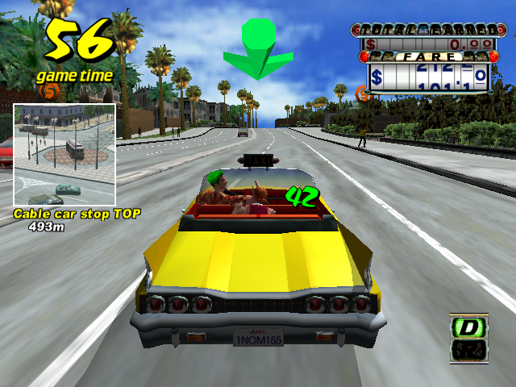
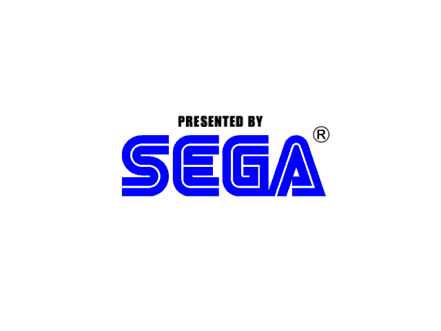
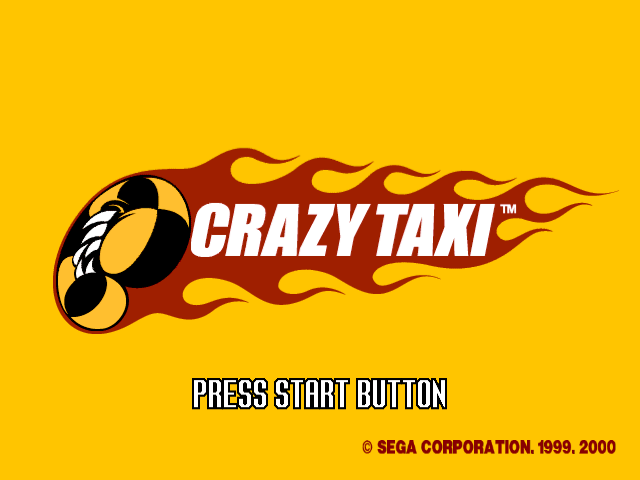
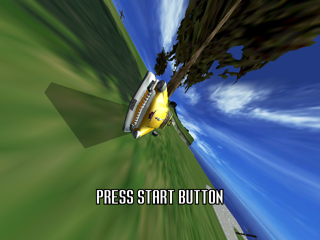
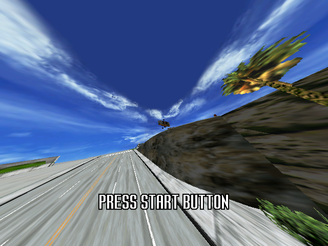

# Crazy Taxi (PC) — Static Recompilation

Static recompilation of **Crazy Taxi** (SEGA / Strangelite, PC release 2002)
from its shipping Windows executable, `CRAZY_TAXI_PC.EXE` (the US CD), to
native C. It runs SEGA's own code, recompiled, on the real Direct3D 8,
DirectInput 8, DirectSound and DirectShow: not an emulator, a wrapper or a
remake.

Built on the [pcrecomp](https://github.com/sp00nznet/pcrecomp) toolchain, on
its `main` branch.

## Getting Started

You need **your own copy of Crazy Taxi for PC**: the US CD, an `.iso` of it,
or the folder the game installed to. Nothing from the game is in this
repository or downloaded for you; everything is built on your machine from
your copy. The CD check passes with your disc in the drive or your disc
image mounted. Windows only for now. There is no installer release yet.

### The setup script

1. Download this repository (the green **Code** button, then **Download ZIP**)
   and unzip it somewhere with 4 GB free.
2. Double-click **`Setup.cmd`**.
3. Play with the **`Crazy Taxi`** shortcut in that folder.

The script checks for Python 3.10+, `capstone`, git and the Visual Studio
2022 C++ tools and **asks** before installing any of them. It clones pcrecomp
beside the repo (`main`). It finds the game on your
drives, in the usual install folders, or as a `*taxi*.iso` or `.cue` beside the repo
or in Downloads, or asks (`Setup.cmd -GameDir E:\` skips the question, `-Yes`
answers every install question). Then it catalogs, lifts and builds
`build\crazytaxirecomp.exe`: about 30 minutes the first time. A rerun skips
finished steps; if it stops, it says why, with the details in `setup.log`.

`setup.sh` (Linux, macOS) only says that there is no build there yet. By hand,
step by step: **[docs/building.md](docs/building.md)**.

In the game: Enter starts and pauses, A decides, the arrows drive. Sound is
on from the shortcut (`--sound`).

## Status

**v0.1.0, early alpha. It plays: Start, the menus, an arcade run, and a fare
picked up and driven**, with the keyboard.

| Stage | State |
|---|---|
| Function catalog (`disasm32`, pcrecomp-stp c3fe185) | 8,509 functions, 96.4% of the code range |
| Lift (`run_lift.py --all`) | 8,510 functions, 0 errors, 2.37M lines of C |
| Boot: CD check, Direct3D 8 device, SEGA logo, title | works |
| Attract demo (the city in 3D) | works, at about 50 frames a second |
| Start, menus, an arcade run, a fare | works (fresh Setup lift on pcrecomp main eb34f7e or later: the taxi stays upright and picks up a fare) |
| Windowed | 640x480 (the default); `--fullscreen` is the original's fullscreen |
| Sound and music | DirectSound and DirectShow run; not checked by ear |
| Gamepad | not tested |
| Headless | `--headless` hides the window; no `--record` yet |
| Conformance harness | none yet; scripted runs with `--key` and `--shot` ([docs/testing.md](docs/testing.md)) |

Setup.cmd was run from a fresh clone, cloning pcrecomp-stp from GitHub,
through the lift and build to the shortcut (2026-11-12), and that build
picked up a fare in the scripted run of [docs/testing.md](docs/testing.md). [docs/lifting.md](docs/lifting.md)
is the log of each wall and its fix, and [ROADMAP.md](ROADMAP.md) what comes
next.

## Screenshots

Real output of `build\crazytaxirecomp.exe --run --shot`, recompiled code
throughout:

| | |
|---|---|
|  |  |
|  |  |

## Documentation

- [docs/building.md](docs/building.md): building by hand, the pcrecomp branch, netlab
- [docs/testing.md](docs/testing.md): scripted keys and shots, a fare, every flag
- [docs/lifting.md](docs/lifting.md): what the host does and why, wall by wall
- [ROADMAP.md](ROADMAP.md), [CHANGELOG.md](CHANGELOG.md), [CONTRIBUTING.md](CONTRIBUTING.md)

## Contributors

See **[CONTRIBUTORS.md](CONTRIBUTORS.md)** for who did what.

## License

MIT for this repository's own code ([LICENSE](LICENSE)). Crazy Taxi is
© SEGA; none of its files, and nothing generated from them, is in this
repository ([NOTICE.md](NOTICE.md)).
